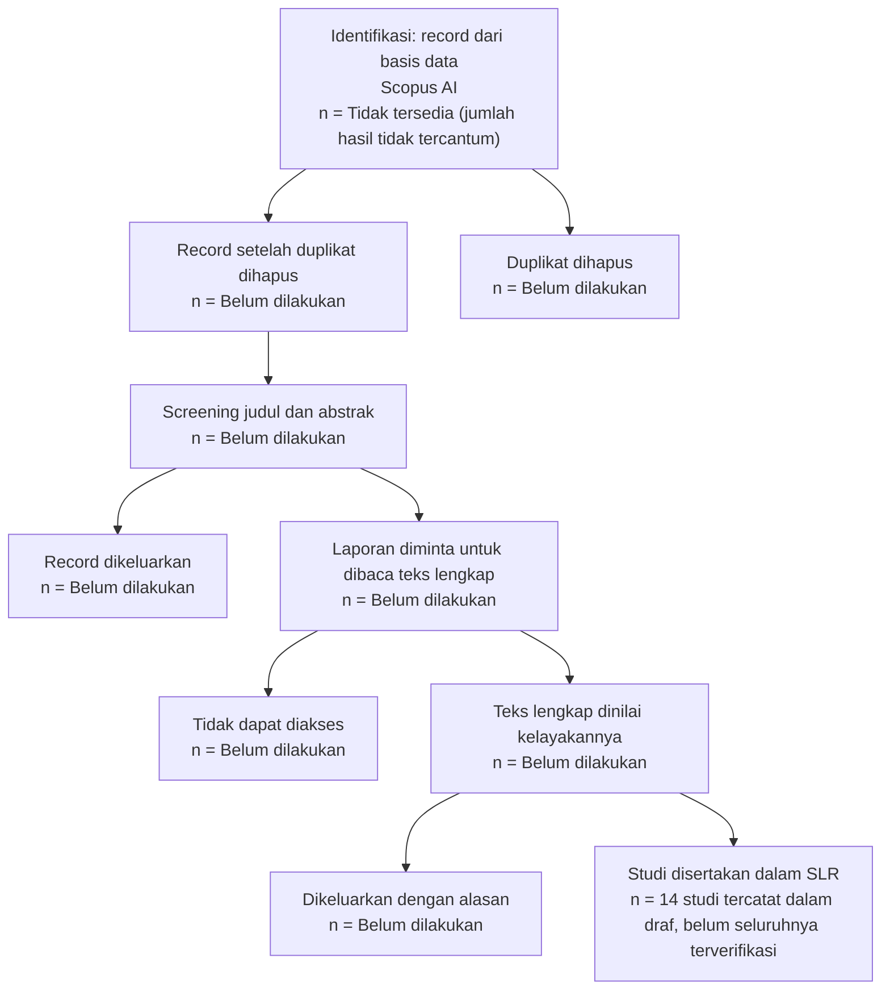

# Systematic Literature Review (SLR): Protokol PRISMA

**Topik:** Analisis Perbandingan Kinerja CNN dan Vision Transformer (ViT) untuk Klasifikasi Citra Wajah Asli dan Citra Wajah Hasil Generative AI
**Penulis:** Teguh Tegar Aulia (20230801124)
**Program Studi:** Teknik Informatika, Fakultas Ilmu Komputer, Universitas Esa Unggul
**Rentang Literatur:** 2021–2026 (dengan pengecualian sumber fundamental yang dirujuk sebagai landasan konseptual)

---

## 1. Research Questions (RQ-SLR)

| Kode | Research Question | Keterkaitan dengan RQ TA |
|---|---|---|
| **RQ-SLR1** | Metode dan arsitektur apa yang digunakan dalam deteksi dan klasifikasi citra wajah asli versus wajah sintetis (GAN, AI-generated, deepfake) pada periode 2021–2026? | Mendukung RQ 1.1 dan RQ 1.2 (karakteristik data dan implementasi teknis) |
| **RQ-SLR2** | Bagaimana CNN, *Vision Transformer*, dan pendekatan *transfer learning* diterapkan dan dibandingkan pada domain citra wajah? | Mendukung RQ 1.2 (implementasi ResNet-50 dan ViT-Base/16) |
| **RQ-SLR3** | Dataset, metrik, dan protokol evaluasi apa yang digunakan untuk menilai kinerja dan generalisasi detektor wajah sintetis? | Mendukung RQ 1.1 dan RQ 1.3 (dataset dan evaluasi performa) |
| **RQ-SLR4** | Apa keterbatasan penelitian terdahulu dan *research gap* yang menjadi posisi penelitian ini? | Mendukung Latar Belakang dan Posisi Penelitian |

---

## 2. Search Strategy

**Database:** Scopus, IEEE Xplore, ScienceDirect, Google Scholar, arXiv (untuk literatur terkini), dan sumber *peer-reviewed* lain. Basis data yang benar-benar digunakan: Scopus AI. Tanggal penelusuran: 11 November 2026.

**String Query (dasar, sesuaikan sintaks tiap basis data):**

```text
("face" OR "facial")
AND ("GAN-generated" OR "AI-generated" OR "synthetic face" OR "fake face" OR "deepfake")
AND ("detection" OR "classification")
AND ("CNN" OR "ResNet" OR "convolutional neural network" OR "Vision Transformer" OR "ViT" OR "transfer learning")
AND PUBYEAR > 2020
```

**Rentang Tahun:** 2021–2026. Sumber fundamental sebelum 2021 (misalnya makalah asli ResNet dan ViT) hanya dirujuk sebagai landasan konseptual dan tidak dihitung sebagai unit analisis. Pastikan sitasinya dimasukkan dari Mendeley: [PERLU VERIFIKASI DI MENDELEY].

**Jumlah hasil penelusuran per basis data:** Belum dapat ditentukan.

---

## 3. Inclusion & Exclusion Criteria

| Kriteria | Inclusion | Exclusion |
|---|---|---|
| Tahun | 2021–2026 (utama); sumber fundamental sebelum 2021 diizinkan terbatas sebagai landasan konseptual | Artikel yang tidak relevan secara temporal dan tidak bersifat fundamental |
| Bahasa | Inggris dan Indonesia | Bahasa lain |
| Jenis | Jurnal *peer-reviewed*, prosiding konferensi, artikel tinjauan (*review*), makalah dataset/*benchmark* | Blog, opini, sumber non-*peer-reviewed*, dokumentasi produk komersial |
| Topik | Deteksi/klasifikasi citra wajah sintetis (GAN, AI-generated, deepfake berbasis wajah); perbandingan atau penerapan CNN, ViT, *transfer learning* pada domain wajah; dataset, *benchmark*, dan evaluasi generalisasi | Penelitian yang tidak berkaitan dengan citra wajah dan tidak berfungsi sebagai pendukung *benchmark*; deteksi berbasis video, audio, atau multimodal murni |
| Evaluasi | Melaporkan metode, dataset, atau metrik evaluasi yang dapat ditelaah | Tidak ada informasi metode atau evaluasi yang dapat diverifikasi |
| Peran dalam SLR | Studi domain wajah sintetis (inti); studi domain umum atau tugas wajah lain hanya sebagai **literatur pendukung** dengan batas yang dinyatakan eksplisit | Studi pendukung yang diklaim sebagai bukti langsung kinerja ResNet-50 atau ViT-Base/16 |

---

## 4. PRISMA Flow Diagram

> **Catatan:** Seluruh angka harus diisi dari proses *screening* aktual (mengacu pada PRISMA 2020: Page et al., 2021; pastikan sitasi tersedia di Mendeley: [PERLU VERIFIKASI DI MENDELEY]). Pada draf saat ini terdapat 14 studi yang sudah tercatat (13 pada Tabel 2.1 ditambah 1 pada daftar referensi). Dua slot tambahan (S15 dan S16) masih kosong.



| Tahap | Jumlah | Keterangan |
|---|---|---|
| Identifikasi | Tidak tersedia | Total *record* dari seluruh basis data; jumlah hasil penelusuran belum tercatat |
| Duplikat dihapus | Belum dilakukan | Hapus melalui Mendeley atau perangkat lunak referensi lain |
| *Screening* judul dan abstrak | Belum dilakukan | Berdasarkan kriteria Bagian 3 |
| Dinilai teks lengkap | Belum dilakukan | Catat alasan eksklusi tiap artikel |
| Disertakan | 14 kandidat studi | Target minimal 15 baris ekstraksi; saat ini 14 terisi dan 2 slot kosong. Jumlah studi yang lolos seleksi SLR belum terverifikasi |

---

## 5. Data Extraction Form

| Kode | Penulis–Tahun | Metode / Pendekatan | Dataset / Objek | Hasil Utama | Limitasi & Relevansi |
|---|---|---|---|---|---|
| S1 | Wang et al. (2022) | *Eyes-based Siamese Neural Network* untuk deteksi citra wajah hasil GAN | Citra wajah hasil GAN; dataset rinci: [PERLU VERIFIKASI DI MENDELEY] | Membahas generalisasi antar-GAN dan *robustness* terhadap *post-processing*; nilai metrik: [PERLU VERIFIKASI DI MENDELEY] | Tidak membandingkan ResNet-50 dan ViT-Base/16 dalam protokol penelitian ini. Relevan sebagai studi domain wajah sintetis secara langsung. |
| S2 | Guo et al. (2022) | *Robust Attentive Deep Neural Network* dengan mekanisme perhatian untuk mendeteksi wajah hasil GAN | Wajah hasil GAN; dataset rinci: [PERLU VERIFIKASI DI MENDELEY] | Pendekatan deteksi wajah GAN berbasis pembelajaran mendalam; nilai metrik: [PERLU VERIFIKASI DI MENDELEY] | Tidak membandingkan ResNet-50 dan ViT-Base/16 pada dataset dan protokol yang sama. Memperkuat bahwa deteksi wajah sintetis telah diteliti melalui pendekatan beragam. |
| S3 | Li et al. (2022) | Sistem deteksi *one-class classification* berbasis *Multi-Channel CNN* (MCCNN) | Wajah sintetis dari GAN; dataset rinci: [PERLU VERIFIKASI DI MENDELEY] | Pengujian lintas domain dan penanganan wajah dari GAN berbeda atau belum dikenal; nilai metrik: [PERLU VERIFIKASI DI MENDELEY] | Pendekatan *one-class*, bukan perbandingan langsung ResNet-50 dan ViT-Base/16. Relevan untuk pembahasan *overfitting*, *robustness*, dan generalisasi. |
| S4 | Xue et al. (2023) | Penggabungan informasi wajah **global dan lokal** untuk deteksi wajah palsu hasil GAN | Wajah palsu hasil GAN; dataset rinci: [PERLU VERIFIKASI DI MENDELEY] | Peran fitur lokal dan global pada deteksi; nilai metrik: [PERLU VERIFIKASI DI MENDELEY] | Bukan perbandingan langsung ResNet-50 dan ViT-Base/16. Relevan untuk pembahasan fitur lokal dan global. |
| S5 | Şafak & Barışçı (2024) | CNN ringan dipralatih ImageNet dengan *transfer learning* dan *stacking ensemble* | Citra wajah asli (FFHQ) dan sintetis hasil StyleGAN2; pengujian generalisasi pada CelebA-HQ | Klasifikasi wajah asli vs sintetis pada beberapa arsitektur CNN; nilai metrik: [PERLU VERIFIKASI DI MENDELEY] | Tidak membandingkan ResNet-50 dan ViT-Base/16 dalam protokol penelitian ini. Paling dekat dengan skema *transfer learning* biner wajah asli vs sintetis. |
| S6 | Ciamarra et al. (2026) | Analisis perbedaan proses akuisisi kamera (pencahayaan, reflektansi, posisi elemen citra) antara citra fotografis dan sintetis (*local camera surface frame analysis*) | Wajah hasil GAN; dataset rinci: [PERLU VERIFIKASI DI MENDELEY] | Landasan perbedaan pembentukan citra asli dan sintetis; nilai metrik: [PERLU VERIFIKASI DI MENDELEY] | Tidak membandingkan ResNet-50 dan ViT-Base/16. Menjadi landasan konseptual proses pembentukan citra. |
| S7 | Lin et al. (2025) | Pengembangan dataset AI-Face dan *benchmark fairness* | Dataset wajah AI berskala besar (sekitar sejuta citra) dengan anotasi demografis; jumlah rinci: [PERLU VERIFIKASI DI MENDELEY] | Menekankan skala data, keragaman demografis, dan *fairness*; hasil *benchmark*: [PERLU VERIFIKASI DI MENDELEY] | Bukan perbandingan langsung ResNet-50 vs ViT-Base/16. Relevan untuk isu komposisi dataset dan penafsiran hasil. |
| S8 | Zhu et al. (2023) | *Benchmark* GenImage untuk deteksi citra hasil AI | Citra umum (bukan khusus wajah); jumlah dan generator: [PERLU VERIFIKASI DI MENDELEY] | Konteks evaluasi lintas generator; hasil: [PERLU VERIFIKASI DI MENDELEY] | Bukan dataset wajah sehingga hanya sebagai literatur pendukung. Hasil pada citra umum tidak dapat disamakan dengan citra wajah. |
| S9 | Zhang et al. (2025) | Tinjauan deteksi citra hasil AI dan *deepfake* (model generatif, kerangka deteksi, metode, dataset, metrik) | Literatur deteksi citra AI dan *deepfake*; jumlah studi: [PERLU VERIFIKASI DI MENDELEY] | Memetakan metode, dataset, metrik, serta tantangan generalisasi dan *robustness* | Artikel tinjauan, bukan eksperimen komparatif ResNet-50 vs ViT-Base/16. Paling dekat dengan cakupan penelitian. |
| S10 | Rodrigo et al. (2024) | Perbandingan komprehensif CNN dan ViT pada tugas *face recognition* | Dataset *face recognition*: [PERLU VERIFIKASI DI MENDELEY] | Perbandingan keluarga arsitektur pada domain wajah; hasil: [PERLU VERIFIKASI DI MENDELEY] | Tugas pengenalan identitas, berbeda dari klasifikasi wajah asli vs sintetis. Menjadi rujukan perbandingan CNN vs ViT pada domain wajah. |
| S11 | Raza et al. (2026) | Deteksi *deepfake* berbasis *Vision Transformer* dengan *transfer learning* pada beberapa metode generasi | Dataset *deepfake*: [PERLU VERIFIKASI DI MENDELEY] | Penerapan ViT dan *transfer learning* lintas metode generasi; nilai metrik: [PERLU VERIFIKASI DI MENDELEY] | Dataset dan protokol tidak identik; bukan perbandingan langsung ResNet-50 vs ViT-Base/16. Relevan untuk penggunaan ViT pada deteksi sintetis. |
| S12 | Tanfoni et al. (2024) | Segmentasi wajah dalam klasifikasi *deepfake* dengan *transfer learning* | Dataset *deepfake*: [PERLU VERIFIKASI DI MENDELEY] | Peran pemrosesan wajah pada klasifikasi *deepfake*; nilai metrik: [PERLU VERIFIKASI DI MENDELEY] | Bukan bukti langsung keunggulan model tertentu pada klasifikasi biner dataset penelitian ini. |
| S13 | Kadhim et al. (2025) | Deteksi wajah dengan YOLOv9 dan klasifikasi gender dengan ResNet50 | Citra wajah; dataset: [PERLU VERIFIKASI DI MENDELEY] | Contoh penggunaan ResNet-50 pada citra wajah; nilai metrik: [PERLU VERIFIKASI DI MENDELEY] | Tidak membahas deteksi wajah sintetis sehingga bukan bukti kinerja ResNet-50 pada tugas penelitian ini. |
| S14 | Leyva et al. (2024) | Deteksi sintesis citra wajah menggunakan *Bayesian CNN* (berdasarkan judul: *Data-agnostic Face Image Synthesis Detection using Bayesian CNNs*); rincian: [PERLU VERIFIKASI DI MENDELEY] | [PERLU VERIFIKASI DI MENDELEY] | [PERLU VERIFIKASI DI MENDELEY] | Terdapat pada daftar referensi draf, tetapi belum masuk Tabel 2.1. Baca teks lengkap, lalu putuskan dimasukkan sebagai unit analisis atau tidak. |

**Catatan:** S1–S13 adalah 13 studi pada Tabel 2.1 draf, dan S14 berasal dari daftar referensi draf. Sumber lain yang dirujuk pada narasi Bab I dan II (misalnya Page et al., 2021 sebagai rujukan metode PRISMA) berfungsi sebagai landasan metodologis atau konteks, bukan unit analisis utama.

### 5.1 Identitas Sumber (disalin dari Daftar Referensi draf)

| Kode | Sumber | DOI |
|---|---|---|
| S1 | Wang, Tondi, & Barni (2022), *Frontiers in Signal Processing* | 10.3389/frsip.2022.918725 |
| S2 | Guo et al. (2022), *IEEE Access* | 10.1109/ACCESS.2022.3157297 |
| S3 | Li et al. (2022), *Sensors* | 10.3390/s22207767 |
| S4 | Xue et al. (2023), *Sensors* | 10.3390/s23020616 |
| S5 | Şafak & Barışçı (2024), *PeerJ Computer Science* | 10.7717/PEERJ-CS.2103 |
| S6 | Ciamarra et al. (2026), *Journal on Information Security* | 10.1186/s13635-026-00232-y |
| S7 | Lin et al. (2025), *CVPR* | 10.1109/CVPR52734.2025.00332 |
| S8 | Zhu et al. (2023), *NeurIPS* | 10.52202/075280-3398 |
| S9 | Zhang et al. (2025), *J. King Saud Univ. CIS* | 10.1007/s44443-025-00154-8 |
| S10 | Rodrigo et al. (2024), *Scientific Reports* | 10.1038/s41598-024-72254-w |
| S11 | Raza et al. (2026), *Computers, Materials and Continua* | 10.32604/cmc.2026.084902 |
| S12 | Tanfoni et al. (2024), *Procedia Computer Science* | 10.1016/j.procs.2024.09.255 |
| S13 | Kadhim et al. (2025), *Eng. Technol. Appl. Sci. Res.* | 10.48084/etasr.11830 |
| S14 | Leyva et al. (2024), *Pattern Recognition Letters* | 10.1016/j.patrec.2024.04.008 |

---

## 6. Synthesis & Thematic Analysis

Berdasarkan ekstraksi data dari studi yang tercatat, literatur dikelompokkan ke dalam tiga tema utama. Sintesis ini bersifat **sementara** karena sebagian detail studi masih bertanda [PERLU VERIFIKASI DI MENDELEY].

### Tema 1: Deteksi Wajah Sintetis Hasil GAN, *Robustness*, dan Generalisasi (menjawab RQ-SLR1)

Studi S1–S6 dan S14 membahas deteksi wajah sintetis melalui pendekatan yang beragam: area mata dengan *Siamese network* (S1), jaringan dengan mekanisme perhatian (S2), *one-class classification* dengan MCCNN (S3), fusi informasi wajah global dan lokal (S4), CNN ringan dengan *transfer learning* dan *stacking ensemble* (S5), serta perbedaan proses akuisisi kamera (S6). Tema yang berulang adalah generalisasi antar-generator, *robustness* terhadap pemrosesan lanjutan, dan risiko *overfitting* (S1, S3, S5). Studi-studi ini memperkuat bahwa karakteristik generator dan kondisi pengujian memengaruhi penafsiran hasil. Tidak satu pun dari studi tersebut, menurut draf, membandingkan ResNet-50 dan ViT-Base/16 pada satu dataset dan protokol yang sama. Klaim ini perlu diverifikasi terhadap teks lengkap setiap artikel.

### Tema 2: Dataset, *Benchmark*, dan Evaluasi (menjawab RQ-SLR3)

S7 (AI-Face) menekankan skala data, keragaman demografis, dan *fairness*, sedangkan S8 (GenImage) menyediakan *benchmark* pada domain citra umum. S9 (tinjauan) memetakan metode, dataset, metrik, dan tantangan seperti generalisasi dan ketahanan metode deteksi. Implikasinya, hasil suatu model harus ditafsirkan berdasarkan komposisi dataset dan kondisi pengujian, dan hasil dari domain citra umum tidak dapat langsung disamakan dengan domain wajah. Pada dataset penelitian ini (*shravya11/human-faces-dataset*; *Real* dari CelebA, *AI-Generated* dari StyleGAN/GAN), cakupan generator terbatas dan tidak mewakili model difusi.

### Tema 3: CNN, ViT, dan *Transfer Learning* pada Domain Wajah (menjawab RQ-SLR2)

S10 membandingkan CNN dan ViT pada *face recognition*, S11 menerapkan ViT dengan *transfer learning* untuk deteksi *deepfake*, S12 menggunakan *transfer learning* dengan segmentasi wajah pada klasifikasi *deepfake*, S13 memakai ResNet50 pada deteksi wajah dan klasifikasi gender, dan S5 menerapkan *transfer learning* pada CNN untuk klasifikasi wajah asli vs sintetis. Kelompok ini menunjukkan bahwa kedua keluarga arsitektur dan pendekatan *transfer learning* sudah digunakan pada domain wajah, tetapi pada tugas, dataset, dan protokol yang berbeda-beda. Karena itu, studi pada tema ini berfungsi sebagai literatur pendukung dan bukan bukti langsung keunggulan salah satu model pada tugas penelitian ini.

### Metrik Evaluasi yang Dirujuk dalam Penelitian Ini

$$\text{Accuracy} = \frac{TP+TN}{TP+TN+FP+FN},\quad \text{Precision} = \frac{TP}{TP+FP},\quad \text{Recall} = \frac{TP}{TP+FN}$$

$$\text{Specificity} = \frac{TN}{TN+FP},\quad F1 = 2\times\frac{\text{Precision}\times\text{Recall}}{\text{Precision}+\text{Recall}}$$

---

## 7. Quality Assessment

Skor diberikan pada skala 1–5 berdasarkan empat kriteria: (a) relevansi topik, (b) kekuatan metodologis, (c) kejelasan pelaporan, dan (d) kontribusi terhadap *research gap*.

> **Status:** hanya kriteria (a) yang diberi skor **sementara**, berdasarkan deskripsi relevansi pada Tabel 2.1 draf. Kriteria (b), (c), dan (d) belum dapat dinilai sebelum teks lengkap dibaca, sehingga diberi tanda [PERLU VERIFIKASI DI MENDELEY]. Ubah skor sementara bila hasil pembacaan berbeda.

| Kode | (a) Relevansi (1–5, sementara) | (b) Metodologi | (c) Pelaporan | (d) Kontribusi *gap* | Alasan Singkat |
|---|---|---|---|---|---|
| S1 | 4 | [PERLU VERIFIKASI DI MENDELEY] | [PERLU VERIFIKASI DI MENDELEY] | [PERLU VERIFIKASI DI MENDELEY] | Domain wajah GAN langsung; membahas generalisasi dan *robustness*. |
| S2 | 4 | [PERLU VERIFIKASI DI MENDELEY] | [PERLU VERIFIKASI DI MENDELEY] | [PERLU VERIFIKASI DI MENDELEY] | Deteksi wajah GAN berbasis *deep learning*. |
| S3 | 4 | [PERLU VERIFIKASI DI MENDELEY] | [PERLU VERIFIKASI DI MENDELEY] | [PERLU VERIFIKASI DI MENDELEY] | Relevan untuk generalisasi lintas domain; pendekatan *one-class*. |
| S4 | 3 | [PERLU VERIFIKASI DI MENDELEY] | [PERLU VERIFIKASI DI MENDELEY] | [PERLU VERIFIKASI DI MENDELEY] | Fitur lokal dan global; bukan perbandingan arsitektur. |
| S5 | 5 | [PERLU VERIFIKASI DI MENDELEY] | [PERLU VERIFIKASI DI MENDELEY] | [PERLU VERIFIKASI DI MENDELEY] | Klasifikasi asli vs sintetis dengan *transfer learning* dan uji generalisasi. |
| S6 | 3 | [PERLU VERIFIKASI DI MENDELEY] | [PERLU VERIFIKASI DI MENDELEY] | [PERLU VERIFIKASI DI MENDELEY] | Landasan perbedaan pembentukan citra; bukan perbandingan arsitektur. |
| S7 | 4 | [PERLU VERIFIKASI DI MENDELEY] | [PERLU VERIFIKASI DI MENDELEY] | [PERLU VERIFIKASI DI MENDELEY] | Isu dataset, demografi, dan *fairness* pada wajah AI. |
| S8 | 3 | [PERLU VERIFIKASI DI MENDELEY] | [PERLU VERIFIKASI DI MENDELEY] | [PERLU VERIFIKASI DI MENDELEY] | *Benchmark* citra umum; hanya literatur pendukung. |
| S9 | 5 | [PERLU VERIFIKASI DI MENDELEY] | [PERLU VERIFIKASI DI MENDELEY] | [PERLU VERIFIKASI DI MENDELEY] | Tinjauan paling dekat dengan cakupan penelitian. |
| S10 | 4 | [PERLU VERIFIKASI DI MENDELEY] | [PERLU VERIFIKASI DI MENDELEY] | [PERLU VERIFIKASI DI MENDELEY] | Perbandingan CNN vs ViT pada wajah; tugas berbeda (*recognition*). |
| S11 | 4 | [PERLU VERIFIKASI DI MENDELEY] | [PERLU VERIFIKASI DI MENDELEY] | [PERLU VERIFIKASI DI MENDELEY] | ViT dan *transfer learning* pada deteksi *deepfake*. |
| S12 | 3 | [PERLU VERIFIKASI DI MENDELEY] | [PERLU VERIFIKASI DI MENDELEY] | [PERLU VERIFIKASI DI MENDELEY] | *Transfer learning* dan pemrosesan wajah pada *deepfake*. |
| S13 | 2 | [PERLU VERIFIKASI DI MENDELEY] | [PERLU VERIFIKASI DI MENDELEY] | [PERLU VERIFIKASI DI MENDELEY] | Penggunaan ResNet-50 pada wajah, tetapi bukan deteksi sintetis. |
| S14 | [PERLU VERIFIKASI DI MENDELEY] | [PERLU VERIFIKASI DI MENDELEY] | [PERLU VERIFIKASI DI MENDELEY] | [PERLU VERIFIKASI DI MENDELEY] | Hanya judul yang tersedia pada draf; belum dapat dinilai. |

---

## 8. Research Gap Matrix

> Setiap *gap* di bawah bersifat **sementara** dan merujuk pada isi draf. Klaim bahwa suatu hal "belum diteliti" harus diuji ulang setelah penelusuran selesai dan S15–S16 terisi.

| Jenis Gap | Deskripsi Gap | Didukung Oleh | Posisi Penelitian Ini |
|---|---|---|---|
| Gap Metodologis | Bukti perbandingan langsung yang dapat diverifikasi antara ResNet-50 dan ViT-Base/16 untuk klasifikasi wajah asli vs wajah hasil Generative AI, dengan dataset, pembagian data, prapemrosesan, dan protokol evaluasi yang sama, tampak terbatas. | S1–S6, S9, S10, S11 (tidak ada yang melakukan perbandingan tersebut menurut draf); S15 untuk verifikasi | Eksperimen komparatif terkontrol ResNet-50 vs ViT-Base/16 dengan *transfer learning* (*backbone* dibekukan, *classifier head* dilatih). |
| Gap Dataset / Cakupan Generator | Dataset yang digunakan hanya mencakup *Real* dari CelebA dan *AI-Generated* dari StyleGAN/GAN; studi lain menyoroti generalisasi antar-generator dan keragaman data. | S1, S3, S5, S7, S8, S16 | Menyatakan keterbatasan cakupan generator (termasuk tidak adanya model difusi) dan melakukan audit validitas dataset. |
| Gap Domain Tugas | Perbandingan CNN vs ViT pada domain wajah banyak dilakukan pada *face recognition* atau *deepfake*, bukan klasifikasi biner wajah asli vs sintetis. | S10, S11, S12, S13 | Menempatkan perbandingan pada tugas klasifikasi biner wajah asli vs sintetis. |
| Gap Evaluasi | Perbandingan sering berfokus pada metrik klasifikasi; aspek efisiensi inferensi perlu dikaji lebih lanjut. Keterbatasan klaim ini harus diverifikasi terhadap studi yang ada. | S9 (metrik evaluasi), S15 | Melaporkan *accuracy*, *precision*, *recall*, *specificity*, *F1-score*, *Macro-F1*, *ROC-AUC*, *confusion matrix*, dan waktu inferensi pada perangkat yang sama. |

---

## 9. Kesimpulan & Rekomendasi

### Kesimpulan SLR

Berdasarkan sintesis 14 studi yang tercatat pada draf, penelitian terdahulu telah membahas deteksi wajah sintetis melalui beragam pendekatan, mengangkat isu generalisasi dan dataset, serta menggunakan CNN, ViT, dan *transfer learning* pada domain wajah. Meski demikian, berdasarkan telaah yang dilakukan sejauh ini, bukti perbandingan langsung ResNet-50 dan ViT-Base/16 pada satu dataset wajah, pembagian data, dan konfigurasi pelatihan yang sama tampak terbatas. Penelitian ini mengisi ruang tersebut melalui eksperimen komparatif yang mengukur metrik klasifikasi dan waktu inferensi. Kesimpulan ini belum final dan tidak berarti belum pernah ada penelitian serupa secara mutlak. Pernyataan tersebut perlu diuji kembali setelah penelusuran sistematis selesai dan slot S15–S16 terisi.

### Langkah Lanjutan Penyelesaian SLR

1. Jalankan string pencarian pada tiap basis data, catat tanggal dan jumlah hasil, lalu isi angka pada diagram PRISMA.
2. Baca teks lengkap S1–S14 dan lengkapi seluruh sel [PERLU VERIFIKASI DI MENDELEY] (dataset, metrik, hasil utama).
3. Temukan studi untuk slot S15 (CNN vs ViT pada deteksi wajah sintetis atau *deepfake*) dan S16 (generalisasi lintas generator, termasuk model difusi).
4. Putuskan status S14 (Leyva et al., 2024): masuk sebagai unit analisis atau tidak.
5. Selesaikan penilaian kualitas kriteria (b)–(d) dan revisi skor relevansi sementara.
6. Sinkronkan Tabel 2.1 dan Bagian 2.3 pada Bab 2 dengan hasil akhir SLR.

### Rekomendasi untuk Penelitian Selanjutnya (di Luar Cakupan TA Ini)

1. Memperluas dataset ke generator lain, termasuk model difusi, untuk menguji generalisasi lintas generator.
2. Menambahkan skenario *fine-tuning* penuh pada kedua arsitektur.
3. Menguji ketahanan terhadap *post-processing* (kompresi, pengubahan ukuran, *noise*) dan evaluasi *fairness* demografis.
